# DAV School Management System

A complete school management system for **DAV Public School, Dugda** (Bokaro, Jharkhand 828404):
one Laravel REST API that controls everything, and **four native Android apps** built from one Kotlin codebase.

| App | Who uses it | Package | Colour |
|---|---|---|---|
| **DAV School Admin** | Principal / office (controls the whole system) | `com.davdugda.sms.school` | Indigo |
| **DAV Staff** | Teachers, accountant, librarian, other staff | `com.davdugda.sms.staff` | Teal |
| **DAV Parent** | Parents & guardians (all their children in one login) | `com.davdugda.sms.parent` | Red |
| **DAV Student** | Students | `com.davdugda.sms.student` | Purple |

Each app is a separate install with its own icon, and an account can only sign in to the app made for its role.
The School Admin app creates everything else: sessions, classes, sections, subjects, staff, students
(and their parent logins), timetables, exams, fees, notices, events, library, transport.

Feature set and data model follow the two reference projects
[hrshadhin/school-management-system](https://github.com/hrshadhin/school-management-system)
(academic years, classes/sections, registrations, student & staff attendance, leave, exams, exam rules, grades, marks, results)
and [4jean/lav_sms](https://github.com/4jean/lav_sms)
(student records linked to parents, payments / payment records / receipts, timetables, library books & requests, promotions),
rebuilt as an API + native mobile apps.

```
School_Management_App/
├── backend/        Laravel 12 REST API (Sanctum tokens, role-based), migrations, demo seeder, API smoke test
├── android/        Kotlin + Jetpack Compose + Material 3, MVVM, Retrofit, kotlinx.serialization
│   ├── core/       shared module: API client, models, theme, components, all screens & view models
│   └── app/        4 product flavors: school, staff, parent, student
└── README.md
```

### Screenshots

Rendered by the automated app flow test (real apps, real API, demo data):

| School Admin | Staff (teacher) | Parent | Student |
|---|---|---|---|
| 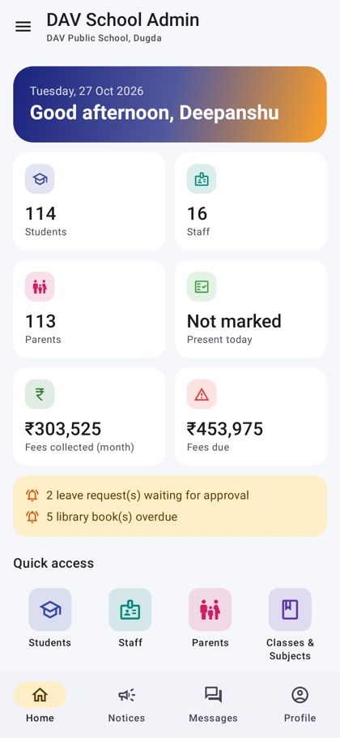 | 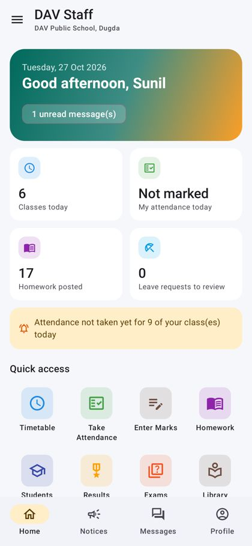 | 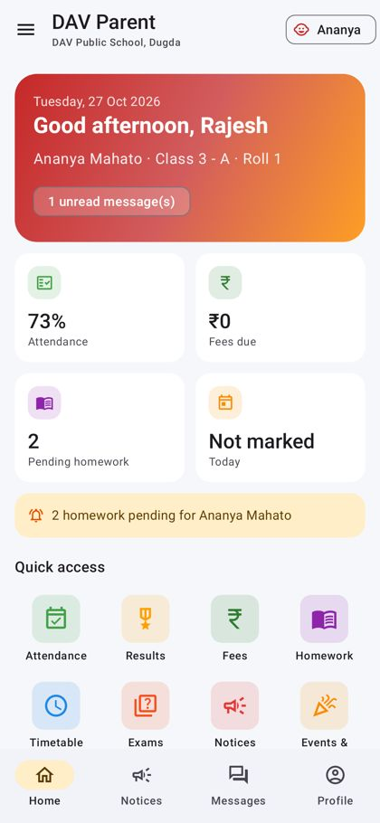 | 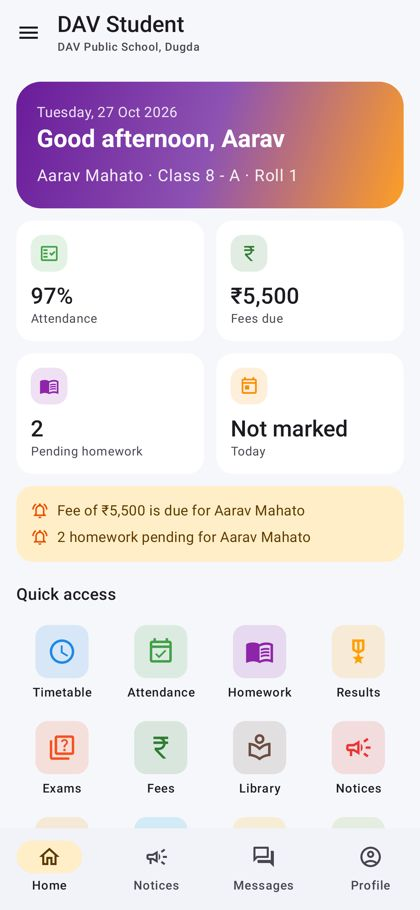 |
| 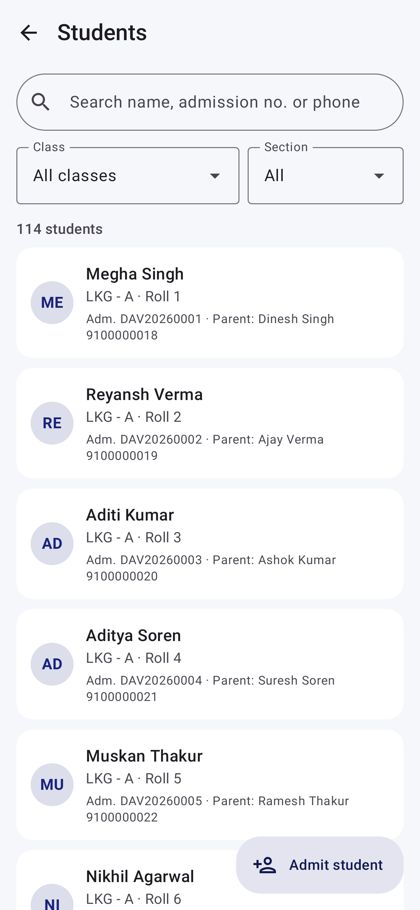 | 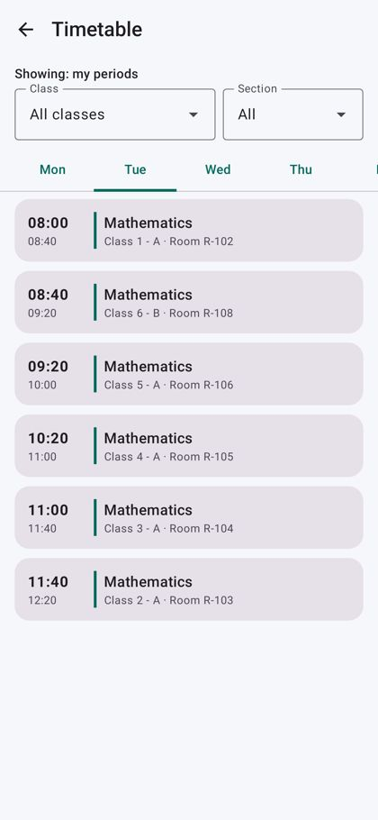 | 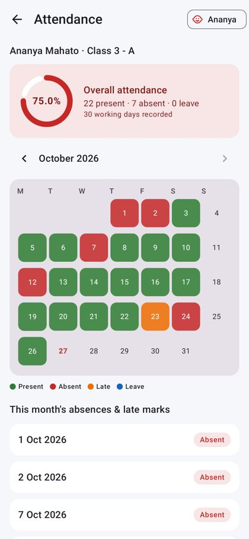 | 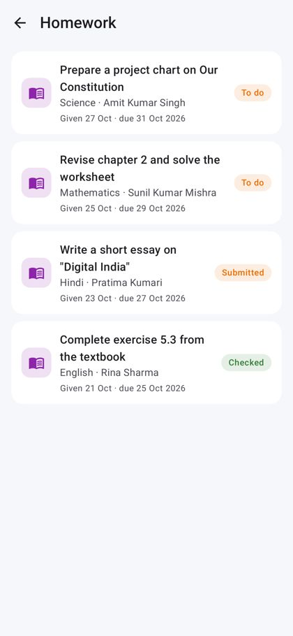 |
| 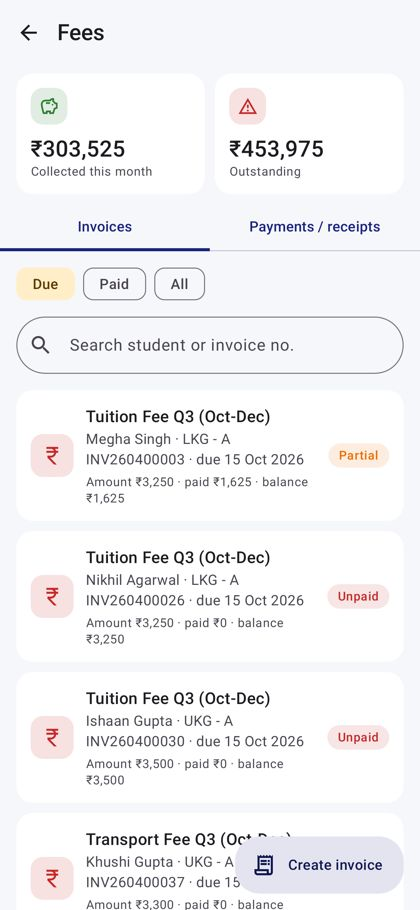 | 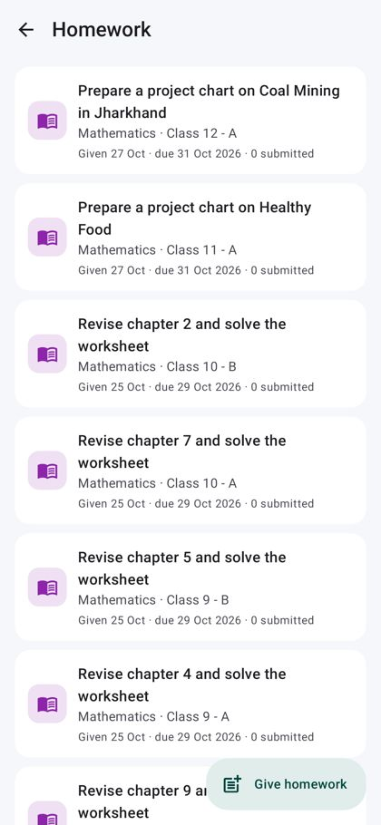 | 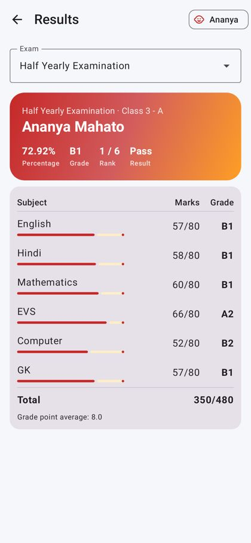 | 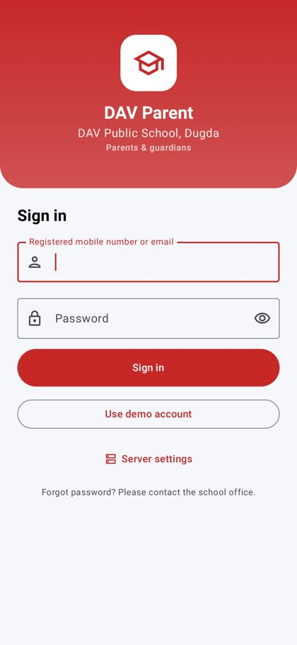 |

---

## 1. Try it in 2 minutes (demo)

1. Install the APKs (from the `releases/` folder if present, or build them, see section 4).
   On the phone allow "Install unknown apps" for your file manager / browser.
2. Open any app and tap **Use demo account**, then **Sign in**.

The APKs point to a free public demo server: `https://dav-dugda-sms.sites.tab.bot/api/v1/`
(change it any time: login screen → **Server settings**, or Profile → Server address).

### Demo logins

| App | Login | Password |
|---|---|---|
| School Admin | `admin@davdugda.in` | `admin123` |
| Staff (teacher) | `teacher@davdugda.in` | `teacher123` |
| Staff (accountant) | `accountant@davdugda.in` | `accountant123` |
| Staff (librarian) | `librarian@davdugda.in` | `librarian123` |
| Parent (2 children) | `parent@davdugda.in` or `9431000001` | `parent123` |
| Student (Class 8-A) | `student@davdugda.in` | `student123` |

Other demo teachers use `teacher123`; demo parents created by the seeder use their phone number + `parent123`.
New logins created from the School app get default passwords (`student123`, `parent123`, `staff123`) unless you set one.

> The demo server is shared and has demo data only. Use your own server (section 3) for real school data.

---

## 2. Features by app

**School Admin app** (role `admin`)
- Dashboard: students, staff, parents, today's attendance, fees collected this month, fees due, alerts (pending leave, overdue books)
- Students: search/filter by class & section, full profile (attendance %, fee dues, parent, bus route), **admit student** (auto admission no., roll no., student login, parent login by mobile), remove
- Staff and Parents: list, search, add (teacher / accountant / librarian / other staff / extra admin), enable/disable login
- Classes & Subjects: classes with sections, class teachers, subjects & subject teachers; add/delete
- Take attendance (any class), staff attendance, timetable editor (clash detection for section and teacher)
- Exams: create, publish/unpublish results, date sheets; marks entry; report cards for any student (percentage, CBSE grade, GPA, rank in section)
- Fees: collection summary, invoices (due/paid), **bill a whole class or section** at once, record payments (cash/UPI/card/bank/cheque) with receipt numbers, payment history
- Homework (all classes), notices (to everyone / staff / parents / students, pin), events & holidays calendar
- Library: catalogue, add books, issue to students, returns with automatic late fine
- Transport: routes, vehicle, driver, stops, timings, fare, students per route
- Leave approvals (approved student leave is written into attendance automatically)
- Messages, school settings (profile, sessions, grade scale, fee types)

**Staff app** (roles `teacher`, `accountant`, `librarian`, `staff`) – screens adapt to the job
- Teacher: today's classes, my timetable (or any class), take attendance for own classes, enter marks for own subjects/classes, give homework and check submissions, students list, report cards, exams, review leave of own students, post notices to parents/students
- Accountant: fee dashboard, invoices, record payments, receipts
- Librarian: catalogue, issue/return, overdue list
- Everyone: my attendance, apply for leave, notices, events, transport, library (my books), messages, profile

**Parent app** (role `parent`)
- Child switcher (one login for all children), dashboard with attendance %, fee due, pending homework, today's status
- Attendance calendar per month, report cards (only after the school publishes results), fees & receipts,
  homework, timetable, exam date sheet, notices, events, transport (child's bus highlighted), apply leave for a child,
  message class/subject teachers and the office

**Student app** (role `student`)
- Dashboard, timetable, attendance calendar, homework (submit answers, see teacher feedback/grade), results,
  exam date sheet, fees, library (my books & due dates), notices, events, leave, transport, messages

---

## 3. Backend (Laravel API)

Requirements: PHP 8.2+ with `pdo_sqlite` or `pdo_mysql`, `mbstring`, `xml`, `curl`, `zip`, `bcmath`; Composer.

### Local

```bash
cd backend
composer install
cp .env.example .env
php artisan key:generate
touch database/database.sqlite            # default DB is SQLite (set DB_CONNECTION=mysql for MySQL)
php artisan migrate --seed                 # creates all tables + the demo school
php artisan serve --host=0.0.0.0 --port=8000
```

- Android emulator: server address `http://10.0.2.2:8000`
- Real phone on the same Wi-Fi: `http://<your-PC-IP>:8000` (e.g. `http://192.168.1.10:8000`)

### Real school (no demo data)

```bash
php artisan migrate --force
php artisan sms:install principal@davdugda.in "a-strong-password" --name="Principal"
```

Then sign in to the **School Admin** app with that email and build the school from the app
(classes → staff → students → timetable → fees ...).

### Free hosting (no credit card) – alwaysdata.com

The free plan (100 MB, PHP 8, MySQL, SSH, HTTPS on `yourname.alwaysdata.net`) is enough for this API.

1. Sign up at **alwaysdata.com** (email only) and pick the **Free** plan. Choose an account name, e.g. `davdugda`.
2. *Databases → MySQL*: create a database (e.g. `davdugda_sms`) and a user.
3. *Remote access → SSH*: enable password login, then connect: `ssh davdugda@ssh-davdugda.alwaysdata.net`
4. On the server:
   ```bash
   git clone https://github.com/RIP09/dav_dugda_bokaro_jharkhand_828404.git
   cd dav_dugda_bokaro_jharkhand_828404/School_Management_App/backend
   composer install --no-dev --optimize-autoloader
   cp .env.example .env && php artisan key:generate
   nano .env    # APP_ENV=production, APP_DEBUG=false, APP_URL=https://davdugda.alwaysdata.net,
                # DB_CONNECTION=mysql, DB_HOST=mysql-davdugda.alwaysdata.net, DB_PORT=3306,
                # DB_DATABASE=davdugda_sms, DB_USERNAME=..., DB_PASSWORD=...
   php artisan migrate --force --seed          # demo data, or: migrate --force + sms:install (above)
   php artisan config:cache && php artisan route:cache
   ```
5. *Web → Sites*: edit the default site → type **PHP**, root directory
   `/home/davdugda/dav_dugda_bokaro_jharkhand_828404/School_Management_App/backend/public`, PHP 8.2 or newer.
6. In each app: **Server settings** → `https://davdugda.alwaysdata.net` (or build the APKs with it, section 4).

To update later: `git pull && composer install --no-dev -o && php artisan migrate --force && php artisan config:cache`.

Avoid free hosts that put a browser "JavaScript check" in front of every request (InfinityFree and similar):
mobile apps calling an API cannot pass it.

### Any Linux server / container

`backend/start.sh` runs the API on `$PORT` (default 8080) with the system PHP, or with a static PHP binary in
`backend/bin/php` if the server has none (download one from https://dl.static-php.dev/static-php-cli/common/ →
`php-8.4.x-cli-linux-x86_64.tar.gz`). It creates and seeds the SQLite database on first start.
This is how the public demo server runs.

### API overview

Base URL `/api/v1`, JSON everywhere (`{"data": ...}`), `Authorization: Bearer <token>` after login.

| Area | Endpoints |
|---|---|
| Auth | `POST auth/login {login, password, app}` · `GET auth/me` · `POST auth/logout` · `POST auth/change-password` · `PUT auth/profile` |
| Home | `GET dashboard[?student_id]` (role-aware) · `GET school` |
| Academic | `classes` · `sections` · `subjects` · `academic-years` (GET all roles; POST/PUT/DELETE admin) |
| People | `students` (CRUD, `POST students/promote`) · `users?role=` (staff/parents/admins, admin CRUD, `toggle-active`) |
| Attendance | `GET/POST attendance/students` · `GET students/{id}/attendance?month=` · `GET attendance/my` · `GET attendance/class-summary` · `GET/POST attendance/staff` |
| Timetable | `GET timetable?section_id= / ?mine=1 / ?student_id=` · `POST/DELETE timetable` |
| Exams | `exams` (CRUD, `publish`) · `exams/{id}/schedules` · `grades` · `GET/POST marks` · `GET students/{id}/report-card` · `GET report-card/my` |
| Fees | `fee-types` · `GET/POST invoices` (single student or whole class) · `POST invoices/{id}/payments` · `GET payments` · `GET fees/summary` |
| Homework | `GET/POST homework` · `POST homework/{id}/submit` · `GET homework/{id}/submissions` · `POST submissions/{id}/review` |
| Communication | `notices` · `events` · `messages` (`?box=inbox|sent`, `contacts`, `unread`) |
| Library | `library/books` · `library/issues` · `POST library/issues/{id}/return` |
| Transport | `transport/routes` · `transport/routes/{id}/students` |
| Leave | `GET/POST leaves` · `POST leaves/{id}/review` · `DELETE leaves/{id}` |

Role rules are enforced on the server (`role:` middleware + ownership checks): parents only see their own
children, students only themselves, teachers only take attendance / enter marks for their own classes and subjects,
fees are admin/accountant, library writes are admin/librarian, and only the admin can create accounts or change structure.

---

## 4. Android apps

Requirements: JDK 17, Android SDK (platform 34, build-tools 34), or just Android Studio (Koala or newer).

```bash
cd android
./gradlew assembleDebug                      # all 4 apps
./gradlew assembleSchoolDebug                # just one (School | Staff | Parent | Student)
./gradlew assembleDebug -PapiBaseUrl=https://davdugda.alwaysdata.net/api/v1/   # bake in your own server
```

APKs: `android/app/build/outputs/apk/<flavor>/debug/app-<flavor>-debug.apk`.
For the Play Store, create a keystore, add a `signingConfig` for `release`, and run `./gradlew bundleRelease`.

Architecture: single-activity Jetpack Compose UI, Material 3 with a per-app brand colour (light & dark),
MVVM (one ViewModel per screen, `core/.../ui/BaseViewModel.kt`), Retrofit + OkHttp + kotlinx.serialization,
a small manual DI container (`AppContainer`), token + server address stored on the device.
The list of screens each app shows is in `core/src/main/java/com/davdugda/sms/core/nav/Features.kt`.

---

## 5. Tests (all run during development)

| Test | Command | What it proves |
|---|---|---|
| API smoke test | `php artisan migrate:fresh --seed && php artisan serve` then `python3 backend/tests/smoke_api.py` | 138 checks across admin, teacher, accountant, librarian, parent and student: every module, plus the blocks (wrong password, wrong app, parent opening another child, teacher billing, marks above max, overpayment, timetable clash, unpublished results, revoked token) |
| API contract test | `cd android && ./gradlew :core:testDebugUnitTest` | 67 real API responses (every role) decode with the apps' models and JSON settings |
| App flow test | backend running on `127.0.0.1:8000`, then `./gradlew :app:testSchoolDebugUnitTest` (and Staff / Parent / Student) | each real app starts (Robolectric), signs in with its demo account, opens its main screens, saves screenshots to `android/app/build/screenshots/` |

---

## 6. Notes & next steps

- Online fee payment (UPI gateway such as Razorpay) is not wired in; payments are recorded by the office/accountant.
  The `payments.method` and `reference` fields are ready for a gateway callback.
- Push notifications (Firebase) and SMS alerts are not included; notices, messages and dashboard alerts cover it in-app.
- Photo upload for students/staff is not in the apps yet (the API has the `photo` field).
- iOS: the API is ready for an iOS app; this repo contains Android only.
