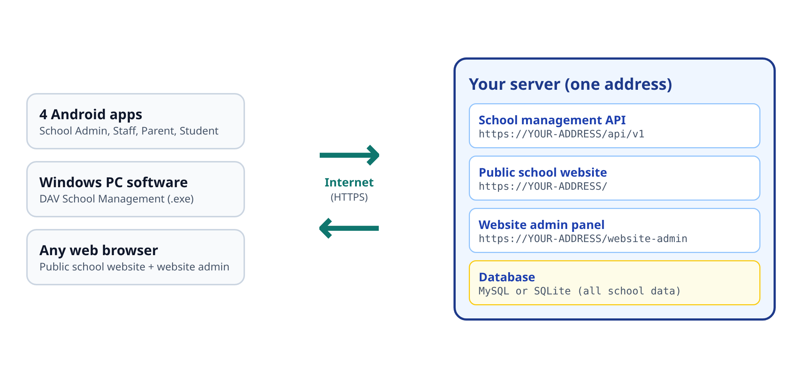
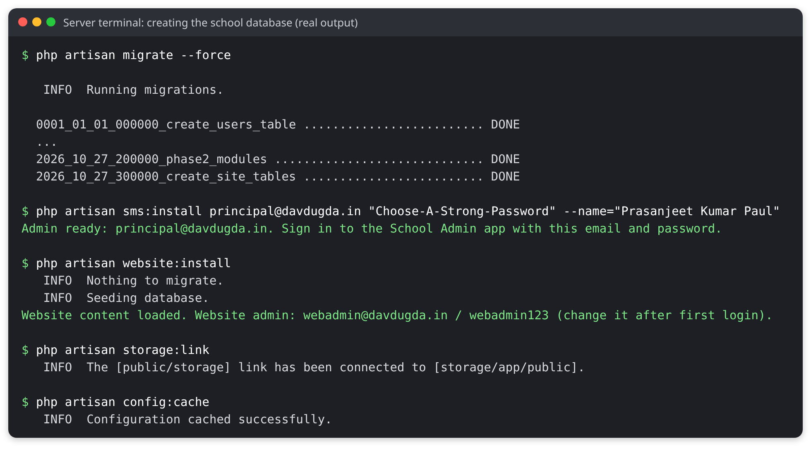
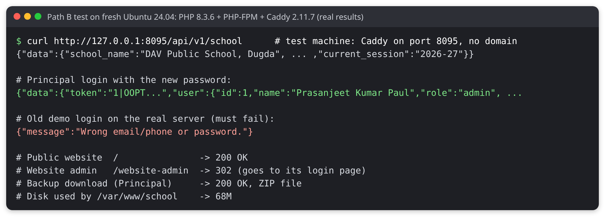
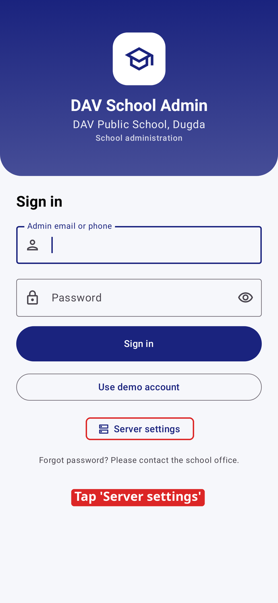
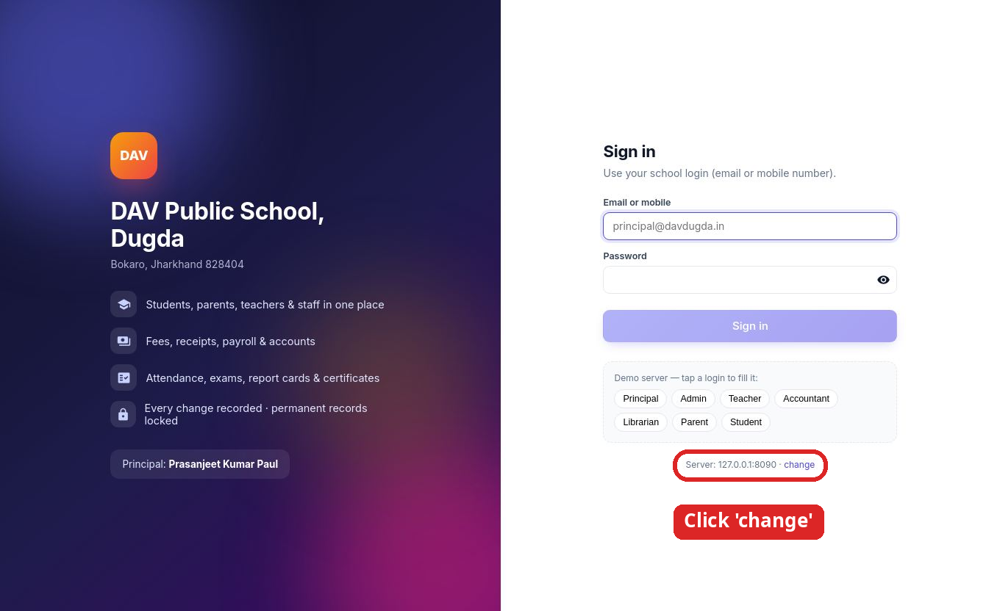

# Go-Live Guide: put DAV School online for free

**DAV Public School, Dugda** (Bokaro, Jharkhand 828404) · Principal: Prasanjeet Kumar Paul

This guide shows you, step by step, how to put the school software on the internet using **free** hosting.
You do not need to be a server expert. Copy each command exactly, press **Enter**, and compare what you see with the
"What you should see" notes.

Time needed: about **1 hour** for Path A, about **2 hours** for Path B.

---

## 1. The big picture



You put **one** thing on the internet: the **server** (the `backend` folder). It gives you three things at one address:

| Address | What it is |
|---|---|
| `https://YOUR-ADDRESS/` | The public school website |
| `https://YOUR-ADDRESS/website-admin` | The website admin panel (edit the website) |
| `https://YOUR-ADDRESS/api/v1` | The school management server that the apps talk to |

The Android apps, the Windows software and the website all use this one address. All school data is saved in one
database on the server.

---

## 2. What is free and what costs money

| Item | Cost |
|---|---|
| The school software (all of it) | Free, open source |
| Path A hosting: alwaysdata Free plan | Free. **No card needed** |
| Path B hosting: Oracle Cloud "Always Free" | Free, but Oracle **asks for a credit/debit card to verify you** (a small temporary hold, then released; you are not charged while you stay on Always Free) |
| Free web address (`davdugda.alwaysdata.net` or `davdugda.duckdns.org`) | Free |
| Your own `.in` domain, e.g. `davdugda.in` | Optional. About ₹500–900 per year (prices change; check the seller) |
| Sharing Android apps by WhatsApp / Google Drive | Free |
| Putting the apps on Google Play Store | Optional. One-time US$25 developer fee |
| Building and sharing the iPhone app | Needs a Mac and Apple Developer Program, US$99 per year (see section 9) |
| Sending files with FileZilla, using PuTTY or Windows Terminal | Free |

---

## 3. Choose your path

| | **Path A: alwaysdata (easiest)** | **Path B: Oracle Cloud (more power)** |
|---|---|---|
| Card needed? | No | Yes, for identity check |
| Difficulty | Easy | Medium |
| Disk / memory | 1 GB disk, 256 MB memory | About 47–200 GB disk, 1–12 GB memory |
| Web address | `davdugda.alwaysdata.net` only (no own domain on the free plan) | Any: free DuckDNS name or your own `.in` domain |
| Backups | alwaysdata keeps 3 days of backups + your own | Only your own |
| Good for | Starting now, a few hundred students | A whole school, many photos and documents |

**My advice:** start with **Path A** today. If the school grows, or alwaysdata's rules do not suit you,
move to Path B later. Your data moves with a backup (section 11).

> **Read this about Path A.** alwaysdata's own pricing page says the Free plan is for personal needs and
> "cannot be used for profit purposes". A school managing its own records is not selling anything, but you
> should read their terms and decide. If you are unsure, use Path B.

**Before you start, you need:**

1. A computer with internet (Windows 10/11 is fine).
2. An email address.
3. A notebook to write down every password you create.

Windows 10 and 11 already have the `ssh` command. Open **Start → type "PowerShell" → open Windows PowerShell**.
All commands in this guide are typed there (after you connect to the server).

In this guide we use the name **`davdugda`**. If that name is taken, choose another and use it everywhere instead.

---

## 4. Path A: alwaysdata (free, no card)

### A1. Create the free account

1. Open **https://www.alwaysdata.com/en/** and click **Free** (or **Plans → Free → Subscribe**).
2. Sign up with your email and a strong password.
3. When asked for an **account name**, type `davdugda` (small letters).

**What you should see:** the alwaysdata admin panel. Your website address will be
**`https://davdugda.alwaysdata.net`**.

### A2. Choose the PHP version

1. In the admin panel open **Environment → PHP**.
2. Choose **PHP 8.3** (8.2 or newer works). Save.

### A3. Create the MySQL database

1. Open **Databases → MySQL**.
2. Click **Add a database**. Name it `davdugda_sms` (alwaysdata puts your account name in front).
3. Create a **user** for it (for example `davdugda_app`) with a strong password, and give it access to
   `davdugda_sms`. **Write down** the user name and password.

The database server address is **`mysql-davdugda.alwaysdata.net`**.

> MySQL is the best choice on alwaysdata, because MySQL support is switched on there by default.
> The software was tested with MySQL (MariaDB 10.11): all tables and data were created without errors.

### A4. Switch on SSH and connect

1. Open **Remote access → SSH**. Edit the user `davdugda`, tick **Enable password login**, set a password, save.
2. On your PC, in PowerShell, type:

```bash
ssh davdugda@ssh-davdugda.alwaysdata.net
```

3. The first time it asks `Are you sure you want to continue connecting (yes/no)?` Type `yes`, press Enter.
4. Type your SSH password (nothing appears while you type; that is normal) and press Enter.

**What you should see:** a line ending with `$`. You are now typing on the server.

> No PowerShell? alwaysdata also has SSH in the browser at `https://ssh-davdugda.alwaysdata.net`
> (slower, but it works).

### A5. Download the software onto the server

Copy these lines one by one. They download only the two folders the server needs (`backend` and `website`):

```bash
cd ~
git clone --depth 1 --filter=blob:none --sparse \
  https://github.com/RIP09/dav_dugda_bokaro_jharkhand_828404.git school
cd school
git sparse-checkout set School_Management_App/backend School_Management_App/website
cd School_Management_App/backend
```

**What you should see:** `Cloning into 'school'...` and no red error. Type `ls` and you should see
`app  artisan  bootstrap  composer.json  config  database  public ...`.

> Keep the folders exactly as they are. The `backend` folder needs the `website` folder next to it.

### A6. Install the parts the software needs

```bash
composer install --no-dev --optimize-autoloader
```

This takes 1–5 minutes. **What you should see** at the end: `Generating optimized autoload files` and no red
`Error`. The installed parts use about **61 MB**; the whole server folder about **64 MB** (we measured it).
That fits easily in the 1 GB free disk.

If you see `composer: command not found`, type these two lines instead (they download Composer into this folder):

```bash
curl -sS https://getcomposer.org/installer | php
php composer.phar install --no-dev --optimize-autoloader
```

Check that PHP has everything it needs:

```bash
for e in pdo_mysql mbstring xml xmlreader xmlwriter dom zip gd fileinfo curl; do
  php -m | grep -qix "$e" && echo "OK       $e" || echo "MISSING  $e"
done
```

**What you should see:** `OK` on every line. If one says `MISSING`, open **Environment → PHP** in the admin panel,
add a line `extension = NAME.so` (for example `extension = xmlreader.so`) to the php.ini box, save, and run the check again.

### A7. Create the settings file (.env)

```bash
cp .env.example .env
php artisan key:generate
nano .env
```

`nano` is a simple text editor. Use the arrow keys to move. Change these lines so they look like this
(use **your** database user and password from step A3). Lines that start with `#` must lose the `#`:

```ini
APP_ENV=production
APP_DEBUG=false
APP_URL=https://davdugda.alwaysdata.net
LOG_LEVEL=warning

DB_CONNECTION=mysql
DB_HOST=mysql-davdugda.alwaysdata.net
DB_PORT=3306
DB_DATABASE=davdugda_sms
DB_USERNAME=davdugda_app
DB_PASSWORD=your-database-password
```

Save and close: press **Ctrl+O**, **Enter**, then **Ctrl+X**.

> Never leave `APP_DEBUG=true` on a live server. It can show secret details to visitors.

### A8. Create the school database (real school, no demo data)

Choose your own strong password for the Principal in the second line:

```bash
php artisan migrate --force
php artisan sms:install principal@davdugda.in "Choose-A-Strong-Password" \
  --name="Prasanjeet Kumar Paul"
php artisan website:install
php artisan storage:link
php artisan config:cache
php artisan route:cache
php artisan view:cache
```

**What you should see** (this is the real output from our test):



- `migrate` creates all the tables (lines ending in `DONE`).
- `sms:install` creates the **Principal's login** (School Admin app), the school profile, the CBSE grade scale
  and the current session. The school starts **empty**: no demo students, no demo passwords.
- `website:install` creates the public website with its starting content and the **website admin** login
  `webadmin@davdugda.in` / `webadmin123`. **Change this password on the first day** (section 6).
- `storage:link` makes uploaded photos visible.

> **Only want to try the demo first?** Use `php artisan migrate --force --seed` instead of the three install lines.
> It fills the school with sample data and the demo passwords from the README.
> Before real use, empty it again with `php artisan migrate:fresh --force` and then run
> `sms:install` and `website:install` as above. **`migrate:fresh` deletes everything in the database.**

### A9. Point the website to the software

1. In the admin panel open **Web → Sites**. Edit the site that is already there (`davdugda.alwaysdata.net`).
2. **Type:** PHP.
3. **Root directory:** `/school/School_Management_App/backend/public/`
   (paths here start from your home folder `/home/davdugda`).
4. **PHP version:** the same one as in step A2. Save.

### A10. Check that it works

Open these in your phone or PC browser:

1. `https://davdugda.alwaysdata.net/api/v1/school` → you should see text that starts with
   `{"data":{"school_name":"DAV Public School, Dugda"`.
2. `https://davdugda.alwaysdata.net/` → the public school website.
3. `https://davdugda.alwaysdata.net/website-admin` → the website admin login page.

HTTPS (the lock icon) is already on for `*.alwaysdata.net` addresses.

**Your server address for the apps is `https://davdugda.alwaysdata.net`.** Go to section 6.

---

## 5. Path B: Oracle Cloud "Always Free" server

This gives you your own small Linux computer in the cloud that is always on. It is more work, but you get more
space and you can use your own domain.

### B1. Create the Oracle account

1. Open **https://www.oracle.com/cloud/free/** and click **Start for free**.
2. Fill in your details. Choose a **Home Region** close to you (for example **India West (Mumbai)** or
   **India South (Hyderabad)**). You **cannot change** the home region later, and free servers only run there.
3. Add a card for verification. Oracle's FAQ says: credit cards and debit cards that work like credit cards are
   accepted; debit cards with a PIN, virtual, single-use and prepaid cards are **not**. Oracle may place a small
   temporary "authorization" hold that your bank removes in a few days. You are not charged while you only use
   Always Free resources.

> **Important Oracle rules (from Oracle's own pages, October 2026):**
>
> - Free server sizes: up to 2 small AMD servers (`VM.Standard.E2.1.Micro`, 1 GB memory each), or Arm
>   (`VM.Standard.A1.Flex`) servers totalling **2 OCPUs and 12 GB memory**; 200 GB disk in total.
> - Oracle **may reclaim (delete) an Always Free server that looks idle for 7 days** (very low CPU, network and,
>   for Arm servers, memory use). Keep weekly backups (section 11) so you never lose data.
> - An account left unused for 30 days or more may be suspended. Log in to the Oracle console now and then.

### B2. Create the server

1. In the Oracle Cloud console: **☰ menu → Compute → Instances → Create instance**.
2. **Name:** `dav-school`.
3. **Image:** click *Change image* → **Ubuntu** → **Canonical Ubuntu 24.04**.
4. **Shape:** click *Change shape* → **Ampere** → `VM.Standard.A1.Flex` with **1 OCPU and 6 GB memory**
   (or **AMD** → `VM.Standard.E2.1.Micro` if Ampere says "out of capacity"). Look for the
   **Always Free-eligible** label.
5. **Add SSH keys:** choose **Generate a key pair for me** and click **Save private key**. Keep this file safe
   (for example in `C:\Users\YOU\.ssh\dav-school.key`). Without it you cannot log in.
6. Click **Create**. Wait until the status is **Running** and copy the **Public IP address**
   (for example `140.238.1.2`).

### B3. Open the web ports (two places)

Oracle blocks web traffic in **two** places. You must open both.

**Place 1, Oracle network:** on the instance page click the **Subnet** link → **Security Lists** →
**Default Security List** → **Add Ingress Rules**:

- Source CIDR: `0.0.0.0/0`, IP protocol: TCP, Destination port range: `80,443`. Save.

**Place 2, the server's own firewall:** you do this in step B4 after you connect.

### B4. Connect and prepare the server

On your PC, in PowerShell (change the file path and the IP to yours):

```bash
ssh -i C:\Users\YOU\.ssh\dav-school.key ubuntu@140.238.1.2
```

Type `yes` the first time. Now, on the server, open the firewall for web traffic:

```bash
sudo iptables -I INPUT 6 -m state --state NEW -p tcp --dport 80 -j ACCEPT
sudo iptables -I INPUT 6 -m state --state NEW -p tcp --dport 443 -j ACCEPT
sudo netfilter-persistent save
```

Install PHP, Composer and Git (all free; this takes a few minutes):

```bash
sudo apt update
sudo apt install -y git unzip curl nano
sudo apt install -y php8.3-fpm php8.3-cli php8.3-sqlite3 php8.3-mysql php8.3-mbstring \
  php8.3-xml php8.3-curl php8.3-zip php8.3-gd php8.3-bcmath php8.3-intl composer
php -v
```

**What you should see:** `PHP 8.3.6 (cli)` (or a newer 8.3).

Install **Caddy**, a free web server that gets the HTTPS lock certificate for you automatically
(these are the official commands from caddyserver.com):

```bash
sudo apt install -y debian-keyring debian-archive-keyring apt-transport-https
curl -1sLf 'https://dl.cloudsmith.io/public/caddy/stable/gpg.key' | \
  sudo gpg --dearmor -o /usr/share/keyrings/caddy-stable-archive-keyring.gpg
curl -1sLf 'https://dl.cloudsmith.io/public/caddy/stable/debian.deb.txt' | \
  sudo tee /etc/apt/sources.list.d/caddy-stable.list
sudo chmod o+r /usr/share/keyrings/caddy-stable-archive-keyring.gpg
sudo chmod o+r /etc/apt/sources.list.d/caddy-stable.list
sudo apt update
sudo apt install -y caddy
```

### B5. Get a free web address (DuckDNS)

1. Open **https://www.duckdns.org** and sign in (with Google, GitHub or another listed account).
2. Type a name, for example `davdugda`, and click **add domain**.
3. In the **current ip** box type your server's Public IP (from B2) and click **update ip**.

Your address is now **`davdugda.duckdns.org`**. (Own `.in` domain instead? See section 10.)

### B6. Download and set up the software

```bash
sudo mkdir -p /var/www && sudo chown $USER:$USER /var/www
cd /var/www
git clone --depth 1 --filter=blob:none --sparse \
  https://github.com/RIP09/dav_dugda_bokaro_jharkhand_828404.git school
cd school
git sparse-checkout set School_Management_App/backend School_Management_App/website
cd School_Management_App/backend
composer install --no-dev --optimize-autoloader
cp .env.example .env
php artisan key:generate
nano .env
```

In `nano`, change these lines (on your own server SQLite is the simplest database: one file, nothing to set up):

```ini
APP_ENV=production
APP_DEBUG=false
APP_URL=https://davdugda.duckdns.org
LOG_LEVEL=warning
DB_CONNECTION=sqlite
```

Save with **Ctrl+O**, **Enter**, **Ctrl+X**. Then create the school (choose your own Principal password):

```bash
touch database/database.sqlite
php artisan migrate --force
php artisan sms:install principal@davdugda.in "Choose-A-Strong-Password" \
  --name="Prasanjeet Kumar Paul"
php artisan website:install
php artisan storage:link
php artisan config:cache
php artisan route:cache
php artisan view:cache
sudo chown -R www-data:www-data storage bootstrap/cache database
```

The last line lets the web server write uploads, logs and the database.

### B7. Tell Caddy about the site

```bash
sudo nano /etc/caddy/Caddyfile
```

Delete everything in the file (hold **Ctrl+K** to delete lines) and type this (use your own address):

```text
davdugda.duckdns.org {
    root * /var/www/school/School_Management_App/backend/public
    encode gzip
    php_fastcgi unix//run/php/php8.3-fpm.sock
    file_server
}
```

Save (**Ctrl+O**, **Enter**, **Ctrl+X**) and restart Caddy:

```bash
sudo systemctl restart php8.3-fpm
sudo systemctl reload caddy
sudo systemctl status caddy --no-pager
```

**What you should see:** `active (running)` in green. Caddy now gets a free HTTPS certificate (from Let's Encrypt)
for your address. This can take a minute.

### B8. Check that it works

Open in a browser:

1. `https://davdugda.duckdns.org/api/v1/school` → text starting with `{"data":{"school_name":"DAV Public School, Dugda"`
2. `https://davdugda.duckdns.org/` → the public website
3. `https://davdugda.duckdns.org/website-admin` → website admin login

Before writing this guide we ran the PHP and Caddy install commands of B4, and all of B6 and B7, on a fresh Ubuntu 24.04 system. That test machine had
no public address, so Caddy listened on port 8095 instead of `davdugda.duckdns.org`; the Oracle console, DuckDNS
and the HTTPS certificate step could not be tried there. The result:



**Your server address for the apps is `https://davdugda.duckdns.org`.** Go to section 6.

---

## 6. First day: make it the real school

Do these in order.

1. **Sign in as Principal.** Open the **School Admin** app (or the Windows software), set the server address
   (section 7), and sign in with `principal@davdugda.in` and the password you chose in A8/B6.
2. **School profile.** In the Windows software open **Settings → School settings** and fill in the principal's
   name (*Prasanjeet Kumar Paul*), phone, email, affiliation number, logo and so on. These appear on receipts,
   report cards and certificates.
3. **Change the website admin password.** Open `https://YOUR-ADDRESS/website-admin`, sign in with
   `webadmin@davdugda.in` / `webadmin123`, and change the password at once. Then replace the starting text,
   photos, notices and staff list with the school's real ones.
4. **Build the school** from the School Admin app or Windows software: session → classes and sections →
   subjects → staff (teachers, accountant, librarian) → students and parents → fee structure → timetable.
5. **Move your paper registers in.** Use **Import** (Excel/CSV). Ready-made Excel templates are in
   `docs/import_templates/` in the GitHub repository. The import shows a preview before saving.
6. **Give each person their own login.** Staff, parents and students get their own email/phone and password.
   Ask everyone to change their password from **Profile → Change password** in their app.

> **Demo passwords must never be used on the real server.** If you ever loaded the demo data on your own server
> (with `--seed`), the demo logins (`principal123`, `admin123`, `teacher123`, `parent123`, `student123` and others)
> work for anyone who has read the README. Empty the demo data (A8 note) before real use.

---

## 7. Connect the apps to your server

Your server address is `https://davdugda.alwaysdata.net` (Path A) or `https://davdugda.duckdns.org` (Path B).
Type it without `/api/v1`; the apps add that part themselves.

### Android apps (School Admin, Staff, Parent, Student)



The apps start connected to the free **demo** server. To use your own server:

1. On the login screen tap **Server settings**.
2. Type your server address and save.
3. Sign in.

Already signed in? Open **Profile → Server address** to change it.

### Windows software

On first start the software asks for the server address (**Welcome** screen). Type your address, click
**Test connection** (it should say *Connected to DAV Public School, Dugda*), then **Save & continue**.
To change it later, click **change** next to *Server* on the login screen.



### Website

Nothing to connect. It is part of the server and opens at `https://YOUR-ADDRESS/`.

---

## 8. Share the Android apps with parents, staff and students

You do **not** need the Play Store. Sharing the APK files is free.

1. Put the four APK files in a Google Drive folder (or send them in the school WhatsApp group):
    - `DAV_School_Admin` (office and principal only)
    - `DAV_Staff` (teachers and staff)
    - `DAV_Parent` (parents)
    - `DAV_Student` (students)
2. In Google Drive set the folder to **Anyone with the link can view** and share the link.
3. On the phone: tap the APK. Android says the source is not allowed. Tap **Settings**, turn on
   **Allow from this source** (WhatsApp, Chrome or Files), go back and tap **Install**.
4. Open the app → **Server settings** → type the school's address → sign in.

Tip: send parents a short message with the link, the server address, and "ask the office for your login".

> **Play Store (optional).** Google charges a one-time US$25 developer registration fee, paid by card. It makes
> updates automatic and installing easier, but it is not needed.

---

## 9. iPhone users

- **Today (free):** iPhone users can use the public website in Safari. The management features are in the
  Android apps and the Windows software.
- **Native iPhone app:** the source code is in the `ios/` folder. To turn it into an app you need a **Mac with
  Xcode** and, to give it to other people, the **Apple Developer Program, US$99 per year**. Build steps are in
  `ios/README.md`. This guide cannot do that part for free.

---

## 10. Your own domain (optional, not free)

A name like `davdugda.in` looks more official. It costs about ₹500–900 per year from any domain seller
(prices change; compare before buying).

- **Path A:** the alwaysdata **Free** plan only allows the `alwaysdata.net` address. A custom domain needs a paid
  alwaysdata plan.
- **Path B:** in your domain seller's **DNS settings** add an **A record**: name `@` (and another for `www`),
  value = your server's Public IP. Wait up to a few hours. Then edit `/etc/caddy/Caddyfile`, replace
  `davdugda.duckdns.org` with `davdugda.in, www.davdugda.in`, change `APP_URL` in `.env`, and run:

```bash
cd /var/www/school/School_Management_App/backend
php artisan config:cache
sudo systemctl reload caddy
```

Then update the server address in the apps.

---

## 11. Backups: do this every week

Pick one day (for example every **Saturday**) and do these three steps.

### Step 1: backup from the app

In the Windows software open **Settings → Backup** and download the backup ZIP (it calls
`GET /api/v1/backup/download` and needs the Principal's login). It contains every table as Excel-ready CSV and
JSON, and the whole database file when SQLite is used. Save it on the office PC **and** in Google Drive.

### Step 2: copy the database itself

Path A (MySQL). It asks for the database password:

```bash
mkdir -p ~/backups
mysqldump -h mysql-davdugda.alwaysdata.net -u davdugda_app -p \
  --single-transaction davdugda_sms > ~/backups/school-$(date +%F).sql
```

Path B (SQLite):

```bash
mkdir -p ~/backups
sudo cp /var/www/school/School_Management_App/backend/database/database.sqlite \
  ~/backups/school-$(date +%F).sqlite
```

### Step 3: download the backups to your PC

Use **FileZilla** (free, https://filezilla-project.org). Connect with *Host* `sftp://ssh-davdugda.alwaysdata.net`
(Path A) or `sftp://YOUR-IP` with your key file (Path B), and copy the `backups` folder to your PC.

Keep at least the last 4 weekly backups. alwaysdata also keeps its own 3 days of backups (Path A).
Oracle keeps nothing for you (Path B).

### If something goes wrong: restore

Path A (MySQL), use the date of the backup you want:

```bash
mysql -h mysql-davdugda.alwaysdata.net -u davdugda_app -p \
  davdugda_sms < ~/backups/school-DATE.sql
```

Path B (SQLite):

```bash
cd /var/www/school/School_Management_App/backend
sudo cp ~/backups/school-DATE.sqlite database/database.sqlite
sudo chown www-data:www-data database/database.sqlite
```

We tested the MySQL backup and restore commands on a test copy of the school: the restored database had all
245 users and 114 students.

---

## 12. Updating to a new version

When a new version is pushed to GitHub, connect with SSH and run:

```bash
# Path A:
cd ~/school/School_Management_App/backend
# Path B instead:  cd /var/www/school/School_Management_App/backend

git pull
composer install --no-dev --optimize-autoloader
php artisan migrate --force
php artisan config:cache && php artisan route:cache && php artisan view:cache
```

Path B only, after updating: `sudo chown -R www-data:www-data storage bootstrap/cache database`.

Take a backup (section 11) **before** every update. Never run `migrate:fresh` on the live school: it deletes all data.

---

## 13. Troubleshooting

| What you see | What to do |
|---|---|
| `500 Server Error` page | Set `APP_DEBUG=true` in `.env`, run `php artisan config:cache`, reload the page to read the error, then set it back to `false` and run `config:cache` again. Also read `storage/logs/laravel.log` (`tail -50 storage/logs/laravel.log`). |
| `No application encryption key has been specified` | Run `php artisan key:generate` and `php artisan config:cache`. |
| `SQLSTATE[HY000] [2002]` or `Access denied for user` | The database lines in `.env` are wrong. Check `DB_HOST`, `DB_DATABASE`, `DB_USERNAME`, `DB_PASSWORD` (A3/A7), then `php artisan config:cache`. |
| `could not find driver` | PHP is missing the database extension. Path A: check step A6. Path B: `sudo apt install php8.3-sqlite3 php8.3-mysql` and `sudo systemctl restart php8.3-fpm`. |
| `attempt to write a readonly database` or `Permission denied` in storage | Path B: run `sudo chown -R www-data:www-data storage bootstrap/cache database`. |
| You changed `.env` but nothing changed | Run `php artisan config:cache` after every `.env` change. |
| `composer` stops with `Allowed memory size exhausted` | Run `COMPOSER_MEMORY_LIMIT=-1 composer install --no-dev --optimize-autoloader`. |
| alwaysdata shows `403 Forbidden` or `Not Found` | The Root directory in A9 is wrong. It must end in `backend/public`. Try the full path `/home/davdugda/school/School_Management_App/backend/public/`. |
| Photos or logo do not show | Run `php artisan storage:link` again. Check `APP_URL` is exactly your address with `https://`. |
| Path B: the browser waits and then "took too long to respond" | A port is closed. Check both places in B3 and the `iptables` lines in B4. |
| Path B: Caddy says it cannot get a certificate | The DuckDNS IP must be your server's Public IP, and ports 80 and 443 must be open. Then `sudo systemctl reload caddy`. Check `sudo journalctl -u caddy -n 30 --no-pager`. |
| App says "Could not reach the server" | Open `https://YOUR-ADDRESS/api/v1/school` in the phone's browser. If that works, check the server address in the app (no spaces, starts with `https://`). |
| App login says "Wrong email/phone or password" | On a real install only the users you created exist. Demo logins do not work there (that is correct). |
| Android says "App not installed" | Uninstall the older copy of the same app first, then install again. |
| Oracle: "Out of capacity" when creating the Ampere server | Try again later, or choose the AMD `VM.Standard.E2.1.Micro` shape. |
| `git pull` says your local changes would be overwritten | You edited a file on the server. Run `git stash`, then `git pull` again. |

---

## 14. Quick reference

| Task | Command (run inside the `backend` folder) |
|---|---|
| Create tables | `php artisan migrate --force` |
| First Principal login | `php artisan sms:install EMAIL "PASSWORD" --name="NAME"` |
| Website content + website admin | `php artisan website:install` |
| After any `.env` change | `php artisan config:cache` |
| Speed up (after updates) | `php artisan config:cache && php artisan route:cache && php artisan view:cache` |
| Read the error log | `tail -50 storage/logs/laravel.log` |
| Demo data (testing only) | `php artisan migrate --force --seed` |
| **Delete everything** (careful) | `php artisan migrate:fresh --force` |

---

## Appendix: try it on any Linux computer first (demo mode)

To try the system on a Linux PC or a spare server before going live, the `backend/start.sh` script starts it
with sample data in one command. It uses the computer's PHP 8.2+ (or a static PHP placed in `backend/bin/php`
if the computer has none).

```bash
cd School_Management_App/backend
composer install --no-dev --optimize-autoloader
cp .env.example .env && php artisan key:generate
PORT=8095 ./start.sh
```

**What you should see:** a table of demo logins and then `Server running on [http://0.0.0.0:8095]`.
Open `http://localhost:8095/api/v1/school`. Stop it with **Ctrl+C**.

> `start.sh` is for **demo only**. It loads the demo school with public demo passwords, and it can re-create the
> demo database by itself. Do not use it for the real school; use Path A or Path B.
